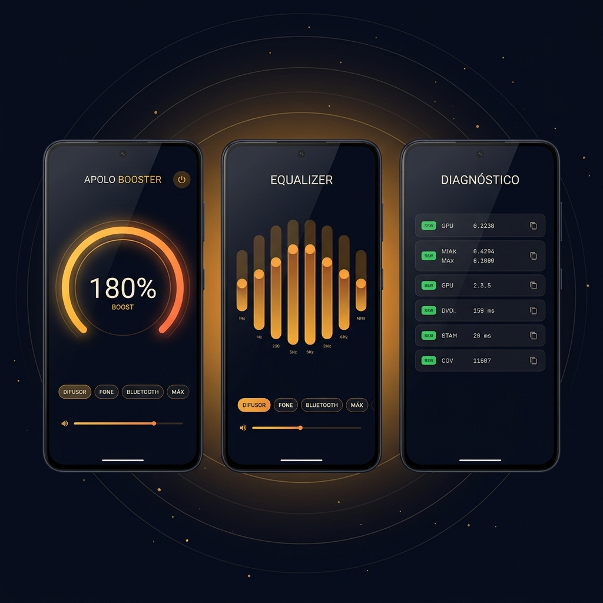

<p align="center">
  
</p>

<p align="center">
  <a href="https://github.com/Ald3b4r4n/apolo-booster/releases/latest"></a>
  
  
  
  
</p>

<p align="center">
  <b>Amplitude além do padrão do sistema — com honestidade técnica e um equalizador de verdade.</b><br />
  <sub>Kotlin · Jetpack Compose · Material 3 · sem root · sem anúncios · sem internet</sub>
</p>

---

## O que é

**Apolo Booster** é um app Android nativo que amplia a loudness de áudio no mix de saída do
sistema: músicas, vídeos, jogos e o som de outros apps. Ele nasceu de uma pergunta simples —
*"por que alguns aparelhos parecem tocar tão baixo?"* — e foi construído em cima do que o
Android realmente oferece: `LoudnessEnhancer`, `Equalizer` e `BassBoost` na sessão global.

O visual é escuro, espacial e responsivo: dial de boost com arco dourado, equalizador por
bandas reais do aparelho e uma tela de **Diagnóstico** que mostra, sem enfeite, o que o seu
hardware suporta.

> [!IMPORTANT]
> **Nenhum app sem root aumenta o ganho físico do alto-falante.** O que boosters fazem — inclusive
> este — é aplicar **ganho digital + compressão** no sinal. Em volumes altos isso significa mais
> pressão sonora e mais distorção. O Apolo Booster diz isso na cara, em vez de prometer milagre.

## Recursos

| | Recurso |
|---|---|
| 🎚️ | **Dial de boost** de 100% a 300% (0 dB a +20 dB), com presets Difusor, Fone, Bluetooth e Máx |
| 🎛️ | **Equalizador** com as bandas e a faixa de ganho reais do aparelho, 5 presets e curvas interpoladas |
| 🔊 | **BassBoost** independente, com intensidade de 0 a 100% |
| 🛰️ | **Turbo de hardware (experimental)** — sonda passos de volume ocultos que alguns OEMs expõem |
| 🩺 | **Diagnóstico copiável** — modelo, API, efeitos disponíveis, bandas, volume e resultado do turbo |
| 🔒 | **Zero rede** — sem `INTERNET`, sem anúncios, sem analytics, sem coleta |
| 🎨 | **Adaptive icon** vetorial, layer monochrome para ícones temáticos e fontes Outfit + Manrope |
| 📱 | **Responsivo** — bottom bar no celular, navigation rail em tablet e paisagem |

## Prints

<p align="center">
  
</p>

<p align="center"><sub>Arte conceitual aprovada da v0.1. Capturas reais de tela entram no repositório a cada release testada.</sub></p>

## Instalação

1. Abra a página de **[Releases](https://github.com/Ald3b4r4n/apolo-booster/releases)**.
2. Baixe o `ApoloBooster-<versão>.apk` mais recente.
3. Permita "instalar de fontes desconhecidas" para o navegador/gerenciador de arquivos.
4. Instale e abra. O Android 8.0 (API 26) é o mínimo.

Atualizações são instaladas **por cima** da versão anterior: todas as builds usam a mesma
chave de assinatura. Se o Android recusar a atualização, desinstale a versão antiga uma única vez.

> [!NOTE]
> O app não está na Play Store. A distribuição é feita exclusivamente pelos releases deste
> repositório — é o mesmo binário que você baixa e o mesmo que o CI compila.

## Como funciona

```
┌──────────────────────────────┐
│ Compose UI                   │  dial, EQ, diagnóstico
└──────────────┬───────────────┘
               │ StateFlow
┌──────────────▼───────────────┐
│ BoostController (singleton)  │  dono único dos AudioEffects
│  • LoudnessEnhancer(0)       │  sessão 0 = mix global
│  • Equalizer(0)              │  bandas reais do aparelho
│  • BassBoost(0)              │  intensidade 0..1000
└──────────────┬───────────────┘
               │ mantém o processo vivo
┌──────────────▼───────────────┐
│ BoostService (FGS)           │  notificação com toggle e parar
└──────────────────────────────┘
```

- **Sessão 0** aplica o efeito no mix de saída. Se o OEM bloquear, o app detecta no probe,
  avisa no Diagnóstico e continua funcionando sem quebrar.
- **Ganho** usa curva linear em dB: 100% = 0 dB, 200% = +10 dB, 300% = +20 dB, com teto global.
- **Equalizador** converte −12..+12 dB para a faixa nativa (`bandLevelRange`) de cada banda.
- **Foreground service** (`mediaPlayback`) mantém os efeitos vivos fora da tela, com notificação
  persistente e ação de parar.
- **Estado** espelhado em `SharedPreferences`: se o processo morrer, a cadeia é reconstruída.

Mais detalhes em [`docs/ARCHITECTURE.md`](docs/ARCHITECTURE.md).

## Privacidade

O app **não declara a permissão `INTERNET`**. Não existe requisição de rede, SDK de anúncio,
telemetria ou identificador de usuário. O relatório de diagnóstico é gerado localmente e só sai
do aparelho se **você** copiar e colar em uma issue.

## Compilar

Sem Android Studio, sem adb, sem emulador. Só JDK 17 e o Android SDK de linha de comando.

```bash
# Linux/macOS
./gradlew testDebugUnitTest assembleRelease

# Windows
gradlew.bat testDebugUnitTest assembleRelease
```

O SDK é localizado por `local.properties` (`sdk.dir=...`) ou pela variável `ANDROID_HOME`.
A assinatura de release lê `keystore.properties` na raiz (não versionado) ou, no CI, as
variáveis `APOLO_KEYSTORE_PATH`, `APOLO_KEYSTORE_PASSWORD`, `APOLO_KEY_ALIAS` e `APOLO_KEY_PASSWORD`.

Versão e versionCode são injetados na build:

```bash
./gradlew assembleRelease -Papolo.versionName=0.1.0 -Papolo.versionCode=100
```

### Pipeline de release

```
tag v*.*.*  →  GitHub Actions (ubuntu)  →  ./gradlew testDebugUnitTest assembleRelease
            →  APK assinado + SHA256SUMS.txt  →  GitHub Release
```

O workflow está em [`.github/workflows/release.yml`](.github/workflows/release.yml).

## Estrutura

```
app/src/main/kotlin/br/com/apolo/booster/
├─ audio/     GainMath · EffectProbe · BoostController · VolumeProbe · EqPresets
├─ service/   BoostService (foreground, notificação, ações)
├─ ui/        ApoloApp · theme/ · components/ · screen/
└─ MainActivity.kt

app/src/test/kotlin/                testes JVM do motor (sem device)
docs/                               arquitetura, instalação, marca e engenharia reversa
docs/assets/                        banner, ícone e arte conceitual
```

## Roadmap

- **0.1.x** — correções do feedback de teste, ajuste fino de curva e clamps por aparelho.
- **0.2.0** — presets salvos, booster memory, quick settings tile e widget.
- **0.3.0** — player interno com cadeia DSP própria (ganho + limiter de verdade) para arquivos locais.
- **0.4.0** — `DynamicsProcessing` com limiter no caminho global, onde o aparelho suportar.

## Feedback

Este projeto é testado no aparelho, não em emulador. Se algo soar errado:

1. Abra **Diagnóstico** no app e toque em **Copiar relatório**.
2. Crie uma issue em [Issues](https://github.com/Ald3b4r4n/apolo-booster/issues/new/choose)
   colando o relatório e descrevendo o cenário (fone, Bluetooth, jogo, música...).
3. Cada release novo traz no corpo o que mudou e o que pedir para testar.

## Licença

MIT — veja [`LICENSE`](LICENSE).

Fontes **Outfit** e **Manrope** sob SIL Open Font License 1.1 (Google Fonts).
Arte conceitual e ícone gerados para o projeto; a marca "Apolo Booster" é deste repositório.
Este projeto não é afiliado ao Google nem a nenhum app de terceiros citado em pesquisas técnicas.
